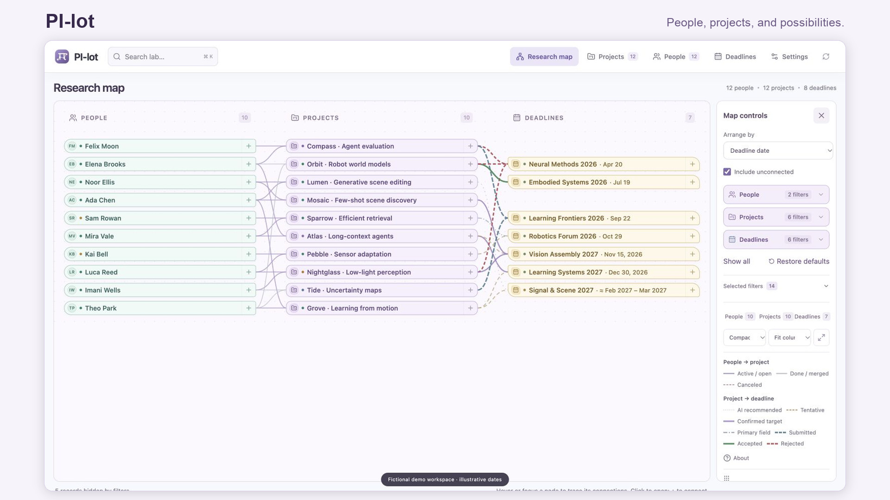

# PI-lot

**A little less lab admin. A little more research.**

PI-lot is a private research workspace that connects **people → projects → deadlines** in one interactive map. Follow a student into their project, explore its submission history, or add a new connection directly on the graph. Use it in your browser, or connect an AI assistant through MCP to help keep it current.

[](https://github.com/assafshocher/PI-lot/raw/refs/heads/main/docs/demo.mp4)

[Watch the 53-second walkthrough](https://github.com/assafshocher/PI-lot/raw/refs/heads/main/docs/demo.mp4) — actual app interactions with entirely fictional data.

[Try it locally](#try-the-demo) · [Deploy your private copy](docs/deployment.md) · [Connect your assistant](docs/ai-connection.md) · [How it works](docs/architecture.md)

## What you can do

- **See the whole lab.** A compact, three-column research graph with distinct people, projects and deadlines; meaningful connection styles; sorting; and independent filters for each kind of record.
- **Move through the relationships.** Open connected records, follow their history, and add people–project or project–deadline links without leaving the map.
- **Keep plans honest.** Distinguish AI suggestions, tentative targets, confirmed plans and actual submissions. Keep earlier rejections visible after a later acceptance.
- **Track the people behind the work.** Students, collaborators and prospective candidates, with custom roles, statuses and next actions.
- **Choose your view.** Lists, compact records, cards and a deadline timeline, with a global search and responsive layouts.
- **Keep context together.** Project descriptions, Markdown and equations, source links, private attachments, dated updates and next steps.
- **Stay in control.** Export your records, merge a backup, restore archived work, and keep project updates and submission history. Concurrent edits are checked before they overwrite anything.

## A real app, with an optional AI connection

PI-lot works without an AI assistant. Its browser interface and database are the application; its MCP server gives an authorized assistant tools to read and update the same records.

The app does **not** call a model API, require an AI API key, or include AI inference in its hosting. You use the account or subscription of your chosen assistant. That assistant must support remote MCP and OAuth; availability and permissions depend on its product and plan. A skill can provide helpful workflows, but it does not replace the running app or its authentication.

## Try the demo

Install **Node.js 24 LTS** and Git, then:

```sh
git clone https://github.com/assafshocher/PI-lot.git
cd PI-lot
npm ci
npm run demo
```

Open **http://127.0.0.1:5174/lab**. The command prepares local configuration when absent, applies local migrations, loads fictional records, and starts the app. No Cloudflare account is needed for this local preview.

Use a fresh clone for the demo. The sample is additive and is not meant to be mixed into your own records. Every person, project, venue, result and source link in the demo was invented from scratch. Dates are illustrative. The demo does not contain renamed private records, imported provenance or original audit history, and it never seeds a remote database. See [demo details](demo/README.md).

## Make it your own

The quickest hosted route is the Cloudflare deployment flow:

[](https://deploy.workers.cloudflare.com/?url=https://github.com/assafshocher/PI-lot)

The deployment creates your own Worker, D1 database, private R2 bucket and OAuth storage. Choose a strong owner password and a separate session secret, then set your exact HTTPS app address. **The app stays locked until its configuration is valid.** Follow the [deployment guide](docs/deployment.md), including the short check after setup. The button is a deployment entry point; it does not make your private workspace public.

For a private local workspace instead:

```sh
npm ci
cp .dev.vars.example .dev.vars
# Edit .dev.vars: set your own OWNER_PASSWORD and SESSION_SECRET.
# Keep DEMO_MODE=false and APP_ORIGIN=http://127.0.0.1:5174.
npm run db:migrate
npm run dev
```

Use a password of at least **16 characters** and an independent random session secret of at least **32 characters**. Keep `.dev.vars` private. If you already ran the demo, use a separate clone for your real workspace.

## Connect an assistant

After private deployment, add this remote MCP URL to a compatible assistant:

```text
https://YOUR-WORKER.YOUR-SUBDOMAIN.workers.dev/mcp
```

Complete PI-lot's owner login and the OAuth permission screen. Start with a read-only request:

> Read my PI-lot workspace. Summarize active projects and upcoming deadlines. Do not change anything yet.

Then try a specific action, such as adding a prospective student, recording a project update with its source, or proposing tentative conference targets. Review saved changes in the app. Manage and revoke AI connections at **`/auth/connections`**.

See [AI connection instructions](docs/ai-connection.md) for Codex, ChatGPT, other clients, and what has and has not been verified. Slack and email access come from your assistant's own authorized connections; PI-lot does not silently connect to either or set up a background schedule.

## Scope and privacy

This release is a **single-owner workspace**. The password holder and approved AI connections have access to that workspace. It does not yet provide separate staff accounts, roles, shared-lab permissions or institution SSO.

Your deployment stores its data in your Cloudflare account. This is not end-to-end encrypted storage: your infrastructure provider operates the storage, and an assistant receives the records you authorize it to read. JSON backups contain private data and do not include attachment binaries. See [security and maintenance](SECURITY.md) and [data portability](docs/data-and-backups.md).

## Development

```sh
npm test
npm run test:integration
npm run build
npm run check:release
```

The code uses React, TypeScript, Vite, Cloudflare Workers, D1, R2 and `@cloudflare/workers-oauth-provider`. It does not require the original app's hosting service. See [architecture](docs/architecture.md) and [contributing](CONTRIBUTING.md).

MIT licensed. Third-party components retain their own licenses; see [notices](THIRD_PARTY_NOTICES.md).
