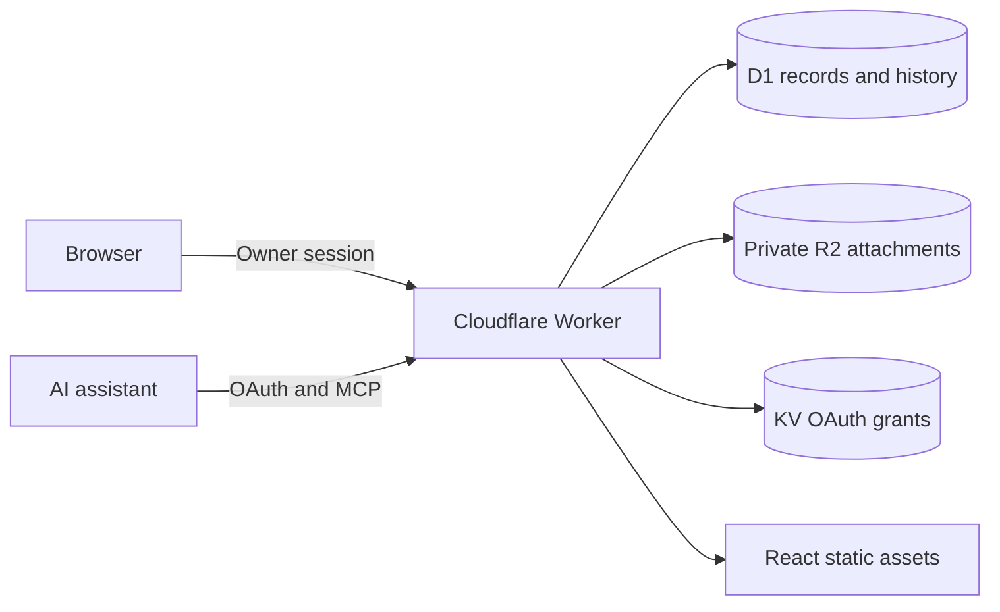

# Architecture

PI-lot is a browser application and a server, with an optional AI interface. It can be used independently of an assistant.

## Application

Vite builds the React/TypeScript interface. The research map, list views, filters, search and record editors live in `components/lab/`. The Worker serves assets and dispatches explicit API, authentication and MCP routes. No server-side React framework or original hosting-service identity is required.

The app is scoped to lab records: people, projects, deadlines, submission targets, project updates and configurable labels. Some shared validation/import code retains support for legacy record formats; the Lab workspace scope rejects unrelated record kinds through the public API.

## Persistence

The `DB` binding is a Cloudflare D1 database. Records carry IDs, revision numbers, timestamps and archive markers. People–project relationships live in a normalized table. Deadline targets are records of their own, keeping plans and actual outcomes distinct.

Mutations use revision checks and idempotency keys. Server-side transactions protect relationships and repeated requests. An audit event records saved changes. Archiving retains the record and its relationships for restoration.

The `BUCKET` binding is private R2 storage. Attachment metadata is stored in D1, and downloads require authentication. The app does not publish a public bucket URL.

## Identity and authorization

This release uses one stable owner identity per deployment. Browser sessions and authorized MCP clients access that same owner workspace. It is not a multi-user lab permission system.

Browser login requires a configured owner password. Session signing uses an independent secret, with origin checks on sensitive browser actions. Authentication fails closed when deployment configuration is missing or invalid. Incoming identity headers are not an alternative to authentication.

The MCP endpoint delegates OAuth protocol handling to `@cloudflare/workers-oauth-provider`, with grant storage in `OAUTH_KV`. Owner login and approval precede access. The app supplies tools; the connected assistant supplies inference. No model API credentials are required by PI-lot.

KV is eventually consistent across Cloudflare locations, so new grants and revocations may take time to propagate. The local integration tests exercise the protocol against isolated storage; they do not simulate worldwide cache propagation. See [KV consistency](https://developers.cloudflare.com/kv/concepts/how-kv-works/).

## Demo and deployment

The optional sample workspace is authored from scratch. The demo runner seeds local D1 only, and demo access is limited to loopback. A hosted installation starts with its own empty storage and valid authentication configuration.

The public repository contains schema and code, not live database contents, real attachments or production credentials. See [deployment](deployment.md), [data and backups](data-and-backups.md), and [security](../SECURITY.md).
